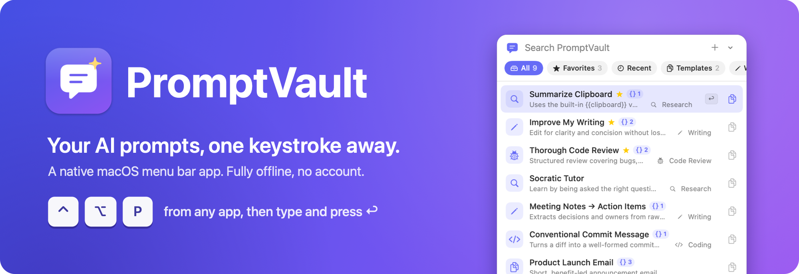
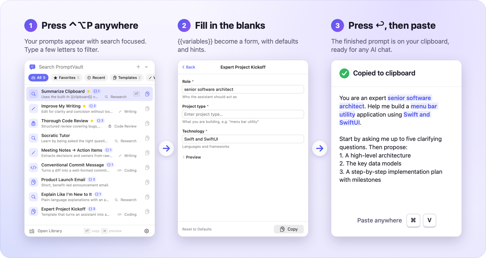
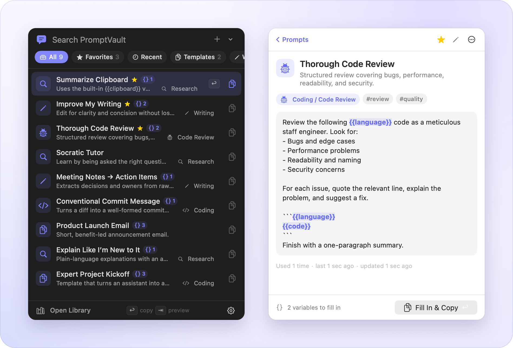
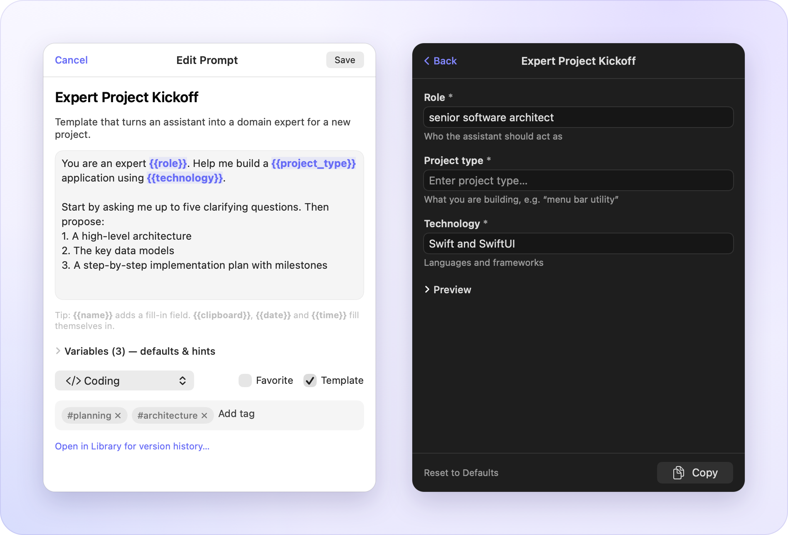
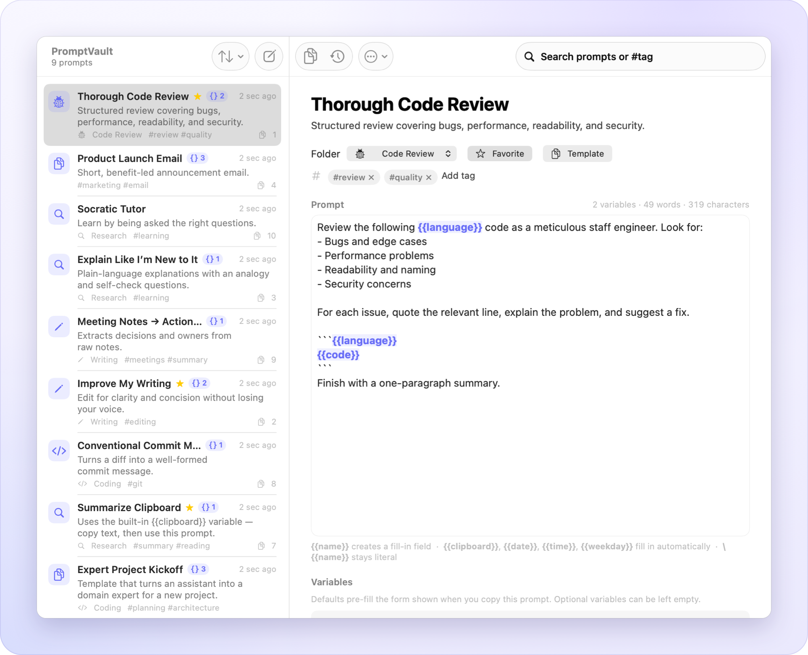
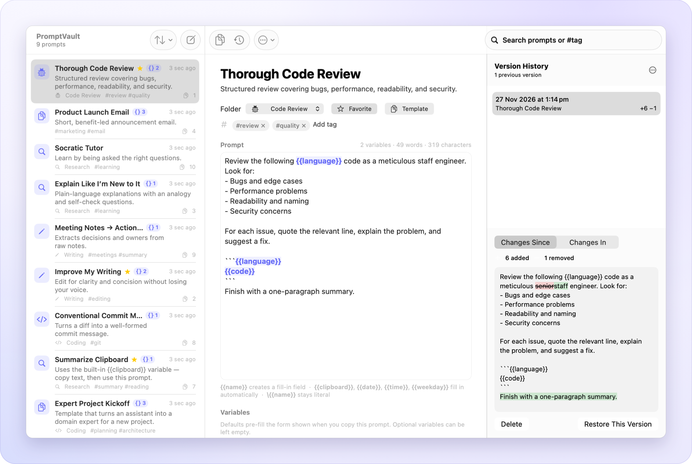

<p align="center">
  
</p>

<p align="center">
  <b>Store, organize, and instantly reuse your AI prompts from the macOS menu bar.</b><br>
  Press <kbd>⌃</kbd> <kbd>⌥</kbd> <kbd>P</kbd> anywhere, type a few letters, press <kbd>↩</kbd>, and the prompt is on your clipboard.
</p>

<p align="center">
  
  
  
  
  
</p>

<p align="center">
  <a href="#how-it-works">How it works</a> ·
  <a href="#features">Features</a> ·
  <a href="#keyboard-shortcuts">Keyboard shortcuts</a> ·
  <a href="#get-promptvault">Get PromptVault</a> ·
  <a href="#architecture">Architecture</a>
</p>

## How it works

<p align="center">
  
</p>

1. **Press <kbd>⌃</kbd> <kbd>⌥</kbd> <kbd>P</kbd> in any app.** Your prompts appear with search focused. Type a few letters to narrow them down.
2. **Fill in the blanks.** If the prompt has `{{variables}}`, they become a short form with defaults and hints.
3. **Press <kbd>↩</kbd>, then paste.** The finished prompt is on your clipboard and focus returns to the app you came from.
   Paste it with <kbd>⌘</kbd> <kbd>V</kbd> into any AI chat, or turn on *Paste into the frontmost app* in Settings.

## Features

### A popover that's one shortcut away

<p align="center">
  
</p>

- Global shortcut (default <kbd>⌃</kbd> <kbd>⌥</kbd> <kbd>P</kbd>, configurable) toggles a compact popover with search focused.
- Instant search across title, description, content, folder, and tags. It is case- and accent-insensitive,
  ranks title matches first, does fuzzy matching on titles, and supports `#tag` filters.
- Collections as chips: All · Favorites · Recent · Templates · folders, plus ⋯ for nested folders and tags.
- Full keyboard control. See [Keyboard shortcuts](#keyboard-shortcuts).
- One-click copy button on every row; click a row for a preview, double-click to copy.
- Quick editor for creating and editing prompts without leaving the menu bar, including
  **New from Clipboard** and **New from Template**.
- A checkmark flashes in the menu bar to confirm a copy.
- Optional **Paste into the frontmost app** after copying (needs Accessibility permission).

### Fill-in variables

<p align="center">
  
</p>

Write `{{role}}` or `{{project type}}` anywhere in a prompt, and it becomes a field in a fill-in form,
with defaults, hints, and required or optional fields.

| You write | You get |
|---|---|
| `{{name}}` | A fill-in field. Names start with a letter or `_` and may contain letters, digits, spaces, `_`, `-`, `.` |
| `{{clipboard}}` | Whatever is on your clipboard when you use the prompt |
| `{{date}}`, `{{time}}`, `{{datetime}}`, `{{weekday}}`, `{{year}}` | The current date or time, in your locale |
| `\{{name}}` | A literal `{{name}}` (useful for Handlebars or Mustache) |

- Values you typed last time are remembered (can be turned off).
- Variables are highlighted as you type in every editor.

### A library for everything else

<p align="center">
  
</p>

- Sidebar with smart collections (All, Favorites, Recently Used, Templates, Uncategorized),
  **nested folders** with custom icons, and **tags** with counts.
- Drag prompts onto folders, Favorites, Templates, or tags. Drag folders to nest them.
- Editor with title, description, folder, tags, favorite and template toggles, variable metadata, and stats.
- Sort by Smart (frequent and recent), Recently Used, Recently Updated, Alphabetical, Most Used, or Date Created.
- Multi-select for bulk favorite, move, tag, export, and delete. Tag manager to rename, merge, or remove tags.
- Overview dashboard: totals, most used, recently used, and a keyboard cheat sheet.

### Version history

<p align="center">
  
</p>

Every save keeps the previous version. Compare versions with a word-level diff ("changes since" / "changes in"),
and restore any of them in one click. Restoring is reversible too.

### Your data stays on your Mac

- Stored locally in `~/Library/Application Support/PromptVault/`. No account, fully offline.
- Export one prompt, a selection, a folder, or everything. Import from JSON, with merge semantics that are
  safe to re-run. Documented open format: [`docs/JSON-FORMAT.md`](docs/JSON-FORMAT.md).
- Automatic daily backups (rotating, default 14 kept), **Back Up Now**, and **Restore from Backup**,
  which saves a safety backup first.
- If the library file can't be opened, it is moved aside (never deleted) and you can start fresh.

## Keyboard shortcuts

**In the popover**

| Shortcut | Action |
|---|---|
| <kbd>⌃</kbd> <kbd>⌥</kbd> <kbd>P</kbd> | Open or close PromptVault from any app (configurable) |
| <kbd>↑</kbd> <kbd>↓</kbd> | Select a prompt |
| <kbd>↩</kbd> | Copy it (fill in its variables first, if it has any) |
| <kbd>⌘</kbd> <kbd>1</kbd> … <kbd>⌘</kbd> <kbd>9</kbd> | Copy the 1st to 9th result |
| <kbd>⇥</kbd> | Preview |
| <kbd>⌘</kbd> <kbd>E</kbd> | Edit |
| <kbd>⌘</kbd> <kbd>D</kbd> | Duplicate |
| <kbd>⇧</kbd> <kbd>⌘</kbd> <kbd>F</kbd> | Favorite |
| <kbd>⌘</kbd> <kbd>N</kbd> | New prompt |
| <kbd>⌘</kbd> <kbd>⌫</kbd> | Delete |
| <kbd>⌘</kbd> <kbd>[</kbd> / <kbd>⌘</kbd> <kbd>]</kbd> | Previous / next collection |
| <kbd>⌘</kbd> <kbd>L</kbd> | Open the library |
| <kbd>Esc</kbd> | Back, or close |

**In the library window**

| Shortcut | Action |
|---|---|
| <kbd>⌘</kbd> <kbd>S</kbd> | Save the prompt you're editing |
| <kbd>⌘</kbd> <kbd>N</kbd> | New prompt |
| <kbd>⇧</kbd> <kbd>⌘</kbd> <kbd>N</kbd> | New folder |
| <kbd>⇧</kbd> <kbd>⌘</kbd> <kbd>I</kbd> | Import prompts |
| <kbd>⇧</kbd> <kbd>⌘</kbd> <kbd>E</kbd> | Export all prompts |
| <kbd>⌘</kbd> <kbd>,</kbd> | Settings |

## Get PromptVault

There's no prebuilt download yet, so for now you build it from source. You need macOS 14 or later to run it,
and Xcode 26 or later to build it (details in [Building](#building)).

```sh
git clone https://github.com/rgtstha/PromptVault.git
cd PromptVault
open PromptVault.xcodeproj        # then press ⌘R
```

PromptVault lives in the menu bar. A brand-new library comes with a few sample prompts to try, so press
<kbd>⌃</kbd> <kbd>⌥</kbd> <kbd>P</kbd> and pick one. You can change the shortcut in Settings.

## Building

Requirements: macOS 14 or later to run. To build, you need a toolchain with Swift 6.2+ features (default
`MainActor` isolation), meaning Xcode 26 or later. Only Xcode 27.2 (Swift 6.4) has been tested. There are
no third-party dependencies.

```sh
open PromptVault.xcodeproj        # then ⌘R
# or from the command line:
xcodebuild -project PromptVault.xcodeproj -scheme PromptVault -configuration Release -derivedDataPath build/DerivedData build
open build/DerivedData/Build/Products/Release/PromptVault.app
```

The project uses Xcode's synchronized folders, so new files in `PromptVault/` or `PromptVaultTests/`
are picked up automatically. It is signed to run locally. Set your team under *Signing & Capabilities*
to distribute it.

### Tests

```sh
xcodebuild -project PromptVault.xcodeproj -scheme PromptVault -derivedDataPath build/DerivedData test
```

The tests cover the template engine, search, the diff, the archive codec, library operations
(versions and autosave coalescing, folders, tags, import merge and replace), on-disk persistence
across reopen, the popover keyboard router, hotkey registration, and performance through
`PromptLibrary` at 10,000 prompts.

An opt-in **live test** drives the real menu bar item and popover through the AppKit event path. It
checks activation and focus on repeated opens, typing, ↓ navigation, ⌘V paste, and ↩ copy. It puts an
item in the menu bar and takes focus for a few seconds. It saves your clipboard and restores it afterwards.

```sh
TEST_RUNNER_PROMPTVAULT_UI_TESTS=1 xcodebuild … test -only-testing:PromptVaultTests/PopoverLiveTests
```

macOS may refuse to activate an app without real user input. If you're typing in another app while
this test runs, its activation checks can fail.

Opt-in visual snapshots render the popover (light and dark), the library, and settings to PNG:

```sh
TEST_RUNNER_PROMPTVAULT_SNAPSHOT_DIR=/tmp/pv-snaps xcodebuild … test -only-testing:PromptVaultTests/SnapshotRenderTests
```

### Development tips

- Run against a throwaway library with `PROMPTVAULT_DATA_DIR=/tmp/pv ./PromptVault` or the launch argument
  `-PromptVaultDataDirectory /tmp/pv`. A brand-new library is seeded with sample prompts.
- Logs: `log stream --predicate 'subsystem == "app.promptvault.PromptVault"'`.
- Regenerate the app icon: `swift scripts/generate-icon.swift PromptVault/Resources/Assets.xcassets/AppIcon.appiconset`.
- Regenerate the README images in `docs/images/`: render the snapshots above into `/tmp/pv-snaps`, then run
  `swift scripts/generate-readme-images.swift /tmp/pv-snaps docs/images` from the repository root.

## Architecture

```
PromptVault/
  App/            AppDelegate (lifecycle), StatusItemController (menu bar item + popover + key routing),
                  window controllers, main menu, AppModel (dependency container + "use prompt" flow),
                  PopoverModel (popover state & keyboard), LibraryState (library window state & edit drafts)
  Models/         SwiftData models (Prompt, Folder, PromptVersion), PromptVariable, LibraryScope/sort orders
  Persistence/    Versioned schema + migration plan, store location, seed content
  Engines/        Pure logic: TemplateEngine, SearchEngine, DiffEngine, PromptArchive (JSON codec)
  Services/       PromptLibrary (all mutations, querying, import/export), AppSettings, hotkey (Carbon),
                  clipboard / auto-paste / launch at login / backups, DataTransfer (panels & alerts), logging
  UI/Popover      Menu bar popover screens: list, preview, fill-in form, quick editor
  UI/Library      Library window: sidebar, prompt list, editor, version history, insights, tag manager
  UI/Settings     Settings window
  UI/Shared       Components, highlighted NSTextView editor, tag editor, variable forms, shortcut recorder
```

Key decisions:

- **Forced activation for the popover.** Cooperative activation (`NSApp.activate()`) can be declined
  for a menu bar app, which leaves the popover visible but unable to take typing. The popover uses
  `activate(ignoringOtherApps:)`, which is deprecated but still needed here.

- **AppKit owns the menu bar item, popover, and windows; SwiftUI renders everything inside them.**
  `MenuBarExtra` can't be opened programmatically, which a global hotkey needs, and doesn't give
  control over focus or keyboard routing. A local key monitor sends popover keys to `PopoverModel`, so
  navigation works while the search field keeps focus.
- **One mutation layer.** Every change goes through `PromptLibrary`, which owns timestamps, versioning,
  tag normalization, and saving. The views never write to SwiftData directly.
- **Search runs in memory** over cached, pre-normalized UTF-8 bytes using `memmem`. Thousands of
  prompts filter on every keystroke without touching the database, and the popover list is lazy.
- **Versions are captured on save, not per keystroke.** The library editor works on a draft that is
  saved with ⌘S, or automatically when you switch prompts, leave the window, or quit. Each ⌘S of
  changed text keeps the previous text as a version. Automatic saves within 5 minutes of the last save
  count as one editing session, so frequent autosaves don't push real history past the cap (50 per
  prompt by default; configurable).
- **Ready for iCloud.** The schema has defaults for every attribute, optional relationships, and no
  unique constraints, which is what CloudKit requires. Turning sync on later is mostly a matter of
  `cloudKitDatabase: .automatic`, the iCloud entitlement, and a sandboxed build.

### App Sandbox and auto-paste

The app ships **unsandboxed with the Hardened Runtime**, because synthesizing ⌘V into another app
(the optional *Paste into the frontmost app* setting, off by default) isn't possible from the App Sandbox.
For a Mac App Store build, enable `ENABLE_APP_SANDBOX`, add the user-selected-file entitlement for
import and export, and hide that setting. Everything else works unchanged.

Accessibility permission is tied to the app's code signature. With local ad-hoc signing, macOS may ask
for it again after each rebuild.
